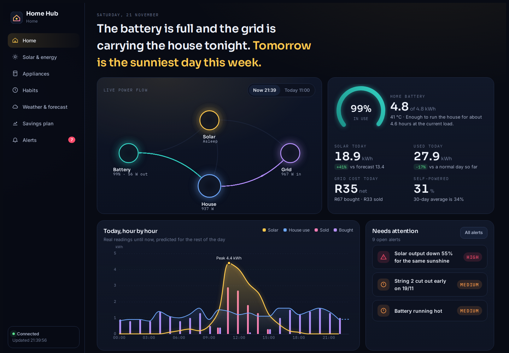
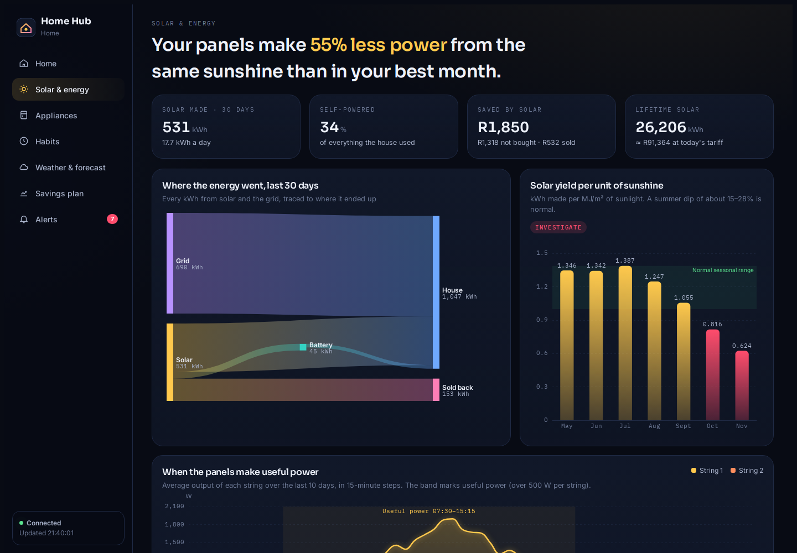
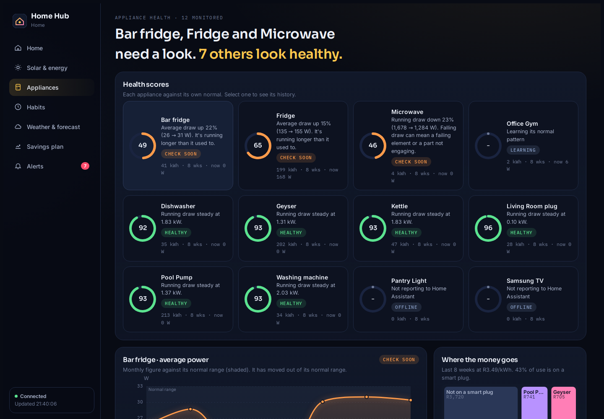
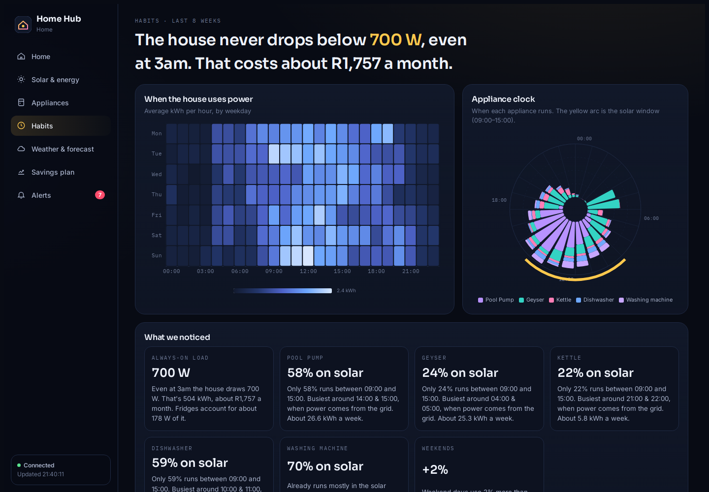
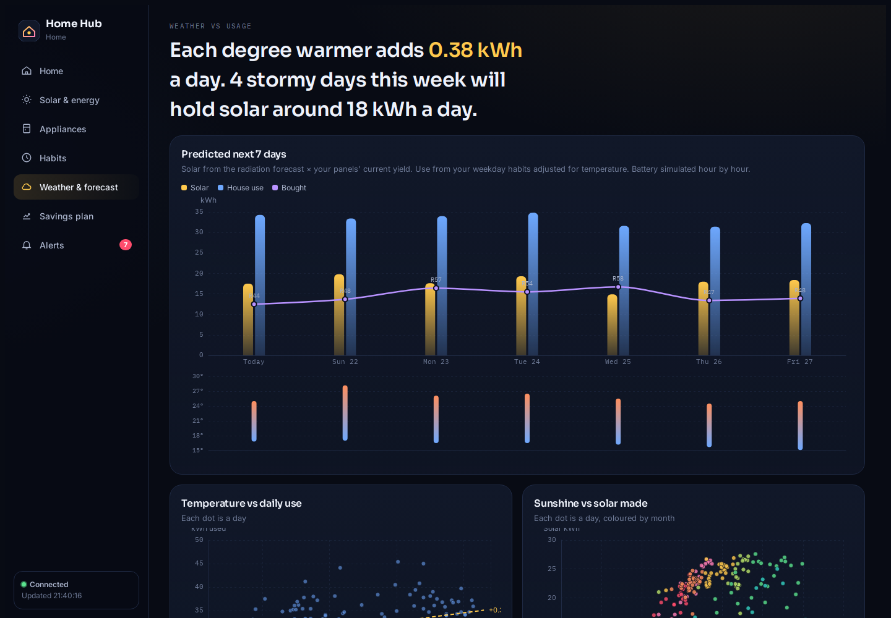
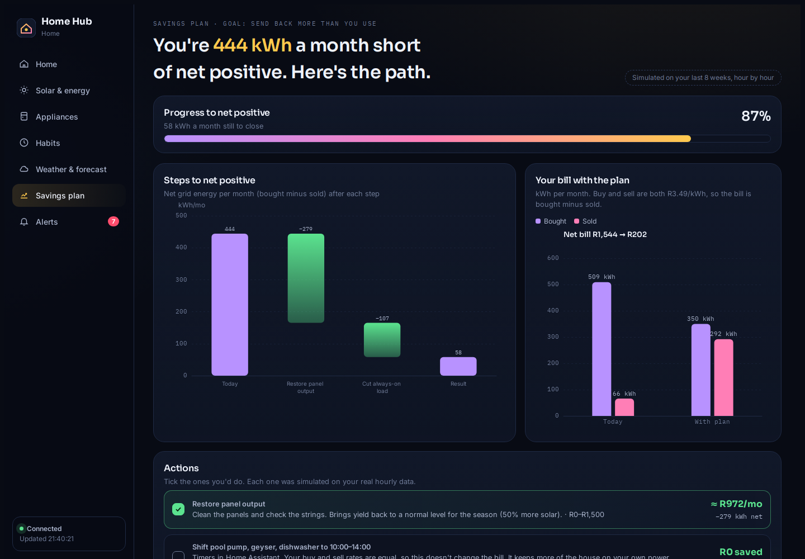
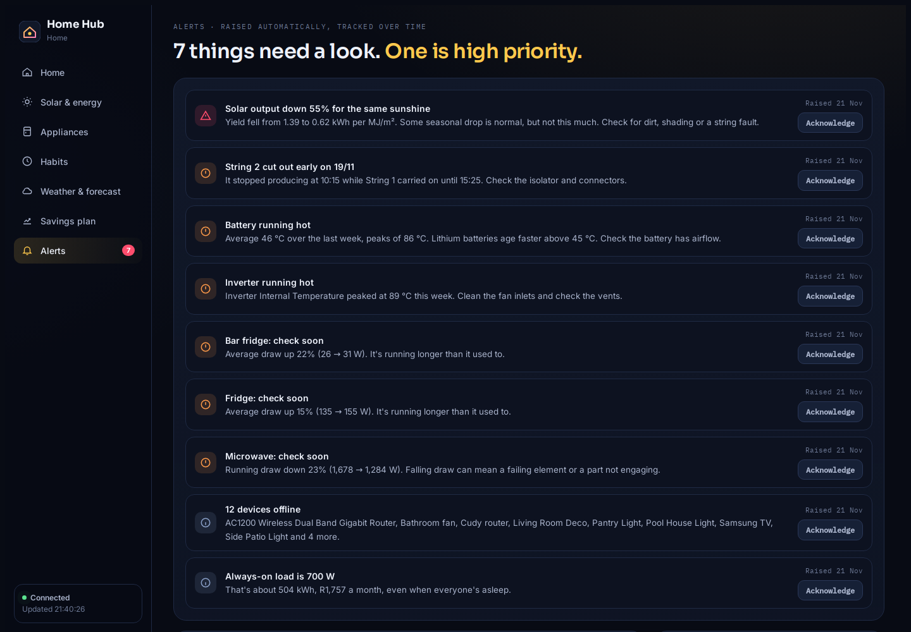
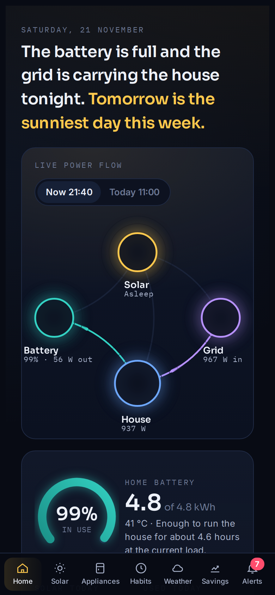

# Home Hub for Home Assistant

A family energy dashboard that runs as a Home Assistant add-on. It covers live power flow,
solar string timing, appliance health, habits, weather vs usage, a 7-day prediction, a plan
to send back more power than you use, and alerts that are tracked over time.

It sets itself up from what's already in your Home Assistant:

- **Solar, battery and grid** come from your **Energy dashboard** settings.
- **Appliances** are any devices with a power sensor (smart plugs, Tasmota, Shelly and so on).
- **Controls** are lights, fans, sprinklers and pumps. Fridge and kettle plugs are left out on
  purpose.

## Install

Click the button to add this repository to your Home Assistant. Then find **Home Hub** in the
add-on store, install it, turn on **Show in sidebar**, and start it.

Or add it by hand:

1. In Home Assistant, go to **Settings → Add-ons → Add-on store**.
2. Open the **⋮** menu, choose **Repositories**, and add:
   `https://github.com/kraythekray/homeassistant-homehub-addon`
3. Find **Home Hub** in the store. Install it, turn on **Show in sidebar**, then start it.

The first start loads up to a year of history from Home Assistant's statistics. This takes about
a minute.

## Screenshots

| | |
|---|---|
| **Solar & energy:** where every kWh went, and solar yield against sunshine  | **Appliances:** health scores against each appliance's own normal  |
| **Habits:** when the house uses power, and the appliance clock  | **Weather & forecast:** a 7-day prediction, and temperature vs usage  |
| **Savings plan:** steps to send back more than you use  | **Alerts:** raised automatically, tracked over time  |

## Add-ons in this repository

| Add-on | Description |
|---|---|
| [Home Hub](home_hub) | Energy dashboard with solar analytics, appliance health, habits, forecasts and alerts. |

## Requirements

- Home Assistant OS or Supervised (add-ons need the Supervisor). Runs on amd64 or aarch64.
- The **Energy dashboard** set up with your solar, grid and (optionally) battery sensors.
- Power-metering plugs or devices, if you want appliance health tracking.
